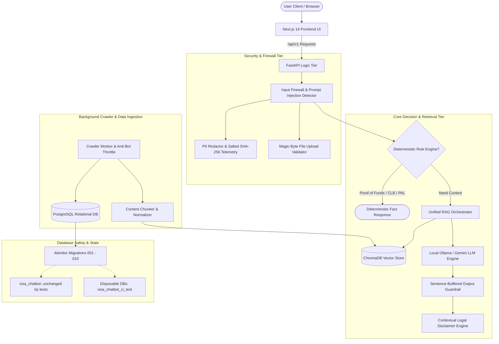

# Pendu Project Status & Architecture Report

**Last Updated:** 2026-10-10  
**Overall Status:** Hardened Internal MVP / Pre-Production Certification  
**Test Suite Health:** 517 / 517 Backend Tests Passing (100%) | Frontend Lint & Static Build Passing Cleanly  
**Branch / Version:** `main` (commit tracked on `origin/main`)

---

## 1. Executive Summary

**Pendu** (Overseas Visa Chatbot) is an AI-powered immigration intelligence platform and automated guidance assistant specifically built for Canadian immigration (IRCC), international student permits, study-to-work pathways, and tourist travel.

The project has transitioned from an exploratory prototype into an enterprise-grade, multi-tier application featuring:
1. **Hardened RAG Pipeline:** Multi-turn conversational memory, strict Canadian immigration constitution grounding, tier-1 IRCC policy primacy, and referential query re-writing.
2. **Deterministic Safety Engines:** Mathematical proof-of-funds verification, CLB language score conversion (IELTS, CELPIP, PTE), and Provincial Attestation Letter (PAL) requirement engines that bypass non-deterministic LLM hallucination.
3. **Multi-Stage Security Firewalls:** Pre-retrieval adversarial input guardrails, post-generation streaming leakage shields (blocking internal prompts, filesystem paths, credentials, and unwarranted legal guarantees), and recursive PII log redaction with salted SHA-256 telemetry.
4. **Resilient Crawler Infrastructure:** Production-grade web crawler pipeline with anti-bot throttling, domain allowlisting, robots.txt compliance, and database migrations (Alembic 001 through 010).
5. **Database Lifecycles & Safeguards:** Tests never modify the development database (`visa_chatbot`; snapshot before/after, upgraded deliberately to `010`), explicit opt-in table auto-creation with allowlist verification, and automated disposable database test runners.
6. **Continuous Integration (CI/CD):** Dual-job GitHub Actions pipeline validating backend tests (unit, integration, and migration lifecycle) and frontend compilation with zero warnings.

---

## 2. Complete System Architecture

### 2.1 Frontend Tier (`frontend/`)
- **Framework:** Next.js 14 App Router, React 18, TypeScript (strict mode).
- **Styling & Assets:** Tailwind CSS, Lucide React icons, Next.js `<Image>` optimization with remote domain allowlists (`images.unsplash.com`).
- **Pages & Routes (12 Static & Dynamic Routes):**
  - `/` (Landing & Value Proposition)
  - `/onboarding` (Applicant background intake: country, education, funds, target intake)
  - `/dashboard` (Application tracker, key deadlines, active alerts)
  - `/visa-risk` (Deterministic visa assessment engine & risk factor breakdown)
  - `/applications` (Document checklists, status tracker, IRCC processing times)
  - `/destinations` (Provincial settlement guides, university tiers, cost-of-living calculators)
  - `/sop` (Statement of Purpose generator addressing profile weaknesses)
  - `/chat` (Streaming RAG conversational assistant with citation badges)
  - `/demo-metrics` (Operational telemetry, latency, token consumption, guardrail catches)
  - Supporting routes: `/profile`, `/settings`, `/notifications`.
- **Tooling:** Package manager pinned to `pnpm@9.15.9`.

### 2.2 Backend Tier (`backend/`)
- **Framework:** FastAPI with asynchronous ASGI execution (`uvicorn`).
- **API Routing:** Modular versioned routes under `backend/app/api/v1/`:
  - `auth.py`: JWT login, registration, refresh token rotation, current user dependency.
  - `chat.py`: Synchronous and streaming RAG endpoints with guardrail instrumentation and audit logging.
  - `visa_risk.py`: Applicant risk scoring and profile evaluation.
  - `crawler.py`: Autonomous crawling jobs, seed URLs, scheduling, and metrics.
  - `files.py`: Secure file upload, magic-byte inspection, metadata stripping, and document sanitization.
  - `profile.py`, `documents.py`, `applications.py`, `health.py`, `notifications.py`, `travel.py`, `tourist_visa.py`.
- **Core Security & Middleware:**
  - `backend/app/core/input_guardrail.py`: Regex and heuristic injection blocking.
  - `backend/app/core/output_guardrail.py`: Post-generation data loss and prompt leakage protection.
  - `backend/app/core/streaming_output_guardrail.py`: Sentence-buffered real-time streaming guardrail.
  - `backend/app/core/legal_disclaimer.py`: Context-aware statutory disclaimers under Canadian law.
  - `backend/app/core/logging_config.py`: Recursive PII redactor and salted SHA-256 user hashing.
  - `backend/app/core/database.py`: Safe session factory, allowlist-protected `init_db()`.
- **AI & RAG Services:**
  - `backend/app/services/unified_rag.py`: Master RAG orchestrator with memory and context filtering.
  - `backend/app/services/rule_engine.py`: Proof of funds, CLB, and PAL statutory rule evaluator.
  - `backend/app/services/llm_orchestrator.py`: Ollama (`llama3.2:3b`) and Gemini abstraction layer.
  - `backend/app/services/embeddings.py`: Local vector embedding generation (`nomic-embed-text`).
  - `backend/app/services/retrieval.py`: ChromaDB dense retrieval with similarity thresholding.
  - `backend/app/services/sop_generator.py`: Tailored Statement of Purpose generation.

### 2.3 Data & Ingestion Layer
- **Relational DB:** PostgreSQL 16 managed via SQLModel ORM and Alembic migrations.
- **Cache & Message Broker:** Redis 7 with Celery workers for async crawler tasks.
- **Vector Database:** ChromaDB vector store storing policy chunks with SHA-256 content hashes.
- **Crawler Subsystem:**
  - `backend/app/services/crawler/`: Playwright and BeautifulSoup scraper with anti-bot throttling (`throttle_manager.py`), backoff retries, robots.txt enforcer, and seed URL dispatching.

---

## 3. Work Completed (Milestones & Engineering Phases)

### 3.1 Milestone 1: Visa Constitution & Input Firewall (Completed)
- **Visa Constitution:** Enforced IRCC source primacy, prohibition against guaranteeing visa approvals, and mandatory disclaimer inclusion.
- **Deterministic Input Guardrail:** Detects prompt injections (e.g., `ignore previous instructions`, `jailbreak`, DAN mode, system delimiter injections) with 103 test cases.
- **Chat Endpoint Hooking:** Integrated guardrails synchronously and asynchronously into `/api/v1/chat/answer` and `/api/v1/chat/answer/stream`.
- **Test Results:** 112 / 112 tests passing (`test_input_guardrail.py`, `test_visa_constitution.py`).

### 3.2 Milestone 2: Unified RAG Pipeline & Multi-Turn Grounding (Completed)
- **Multi-Turn Context Engine:** Conversation history tracking with referential query resolution.
- **Strict Grounding:** Refuses out-of-domain queries or unverified claims; enforces verified IRCC citation links.
- **Context Sanitization:** Strips delimiter tokens from retrieved vector chunks prior to LLM prompt injection.
- **Test Results:** 20 / 20 tests passing (`test_unified_pipeline.py`) + live end-to-end verification.

### 3.3 Milestone 3: Output Guardrail & Leakage Shield (Completed)
- **Sentence-Buffered Streaming Guardrail:** Inspects generated tokens sentence-by-sentence before yielding to client.
- **Shield Protections:**
  - Blocks internal prompt leaks, system delimiter leaks (`<system>`, `===`).
  - Blocks internal filesystem paths (`/app/backend/...`, `C:\...`).
  - Blocks credentials, API keys, and environment variables.
  - Detects and rewrites unauthorized legal guarantees (e.g., *"Your visa is guaranteed"*).
- **Statutory Legal Disclaimer:** Appends non-legal advice disclaimers pursuant to Canadian immigration regulations.
- **Test Results:** 42 / 42 tests passing (`test_output_guardrail.py`, `test_streaming_output_guardrail.py`, `test_legal_disclaimer.py`).

### 3.4 Milestone 4: Deterministic Rules & User Privacy (Completed)
- **Statutory Proof-of-Funds Math:** Deterministic calculator encoding 2024 IRCC cost-of-living adjustments ($20,635 + tuition + family dependents) without relying on LLM math.
- **CLB Language Conversion:** Deterministic mappings for IELTS General/Academic, CELPIP-General, and PTE Core to Canadian Language Benchmark (CLB 4–10).
- **Provincial Attestation Letter (PAL):** Deterministic logic evaluating exemption criteria (Master's/PhD, primary/secondary school, in-Canada extensions).
- **Recursive PII Redactor:** Scrubs passport numbers, IRCC Client ID/UCIs, Canadian SINs, emails, phone numbers, and bearer auth tokens across all loggers (`app.log`, `error.log`, console).
- **Salted SHA-256 Telemetry:** Replaces raw user IDs in logs with cryptographically salted hashes.
- **Magic-Byte Secure File Uploads:** Validates file signatures (PDF `%PDF-`, JPEG `\xFF\xD8\xFF`, PNG `\x89PNG`), enforces 10MB ceiling, strips EXIF/IPTC/PDF metadata, and neutralizes adversarial prompt injections inside uploaded documents.
- **Test Results:** 57 / 57 tests passing (`test_rule_engine.py`, `test_logging_pii_redaction.py`, `test_file_upload_security.py`).

### 3.5 Database Lifecycles & Safeguards (Phase B2.1 - Completed)
- **Alembic Migrations 009 & 010:**
  - `009_crawler_pipeline.py`: Added crawler tables (`crawler_seeds`, `crawler_jobs`, `crawler_page_logs`, `crawler_metrics`, `crawler_change_events`).
  - `010_crawler_anti_bot.py`: Added anti-bot throttle and fingerprint tables (`crawler_domains`, `crawler_fingerprints`, `crawler_proxies`).
- **Development Database Invariant:**
  - Tests and CI never run migrations or destructive operations against `visa_chatbot` / `visa_chatbot_dev`; the migration suite snapshots the dev DB and fails if it changes.
  - The dev DB is upgraded deliberately by the developer (`alembic upgrade head`), after a `pg_dump` backup.
- **Startup Protection (`init_db`):**
  - Defaulted `DATABASE_AUTO_CREATE_TABLES=False`.
  - Restricted table auto-generation exclusively to databases explicitly listed in `DISPOSABLE_DATABASE_ALLOWLIST` (e.g., `visa_chatbot_ci_test`, `visa_chatbot_disposable_migration_test`).
  - Production, staging, unknown, and protected database names reject auto-generation and fail safely.
- **Disposable Database Test Harness:**
  - `test_migration_010_disposable.py` validates complete upgrade/downgrade lifecycles on dynamically created, isolated databases while verifying that `visa_chatbot` is not changed by the tests (revision + tables snapshot).

### 3.6 Continuous Integration & Automation (Phase 2 - Completed)
- **Workflow Configuration (`.github/workflows/ci.yml`):**
  - **Backend Job:** Ubuntu runner, Python 3.12, PostgreSQL 16 service container, Alembic migration test suite, and full 517-test pytest suite.
  - **Frontend Job:** Ubuntu runner, Node 20, pnpm 9.15.9, ESLint code verification, and static production build.

---

## 4. Errors Encountered & Engineering Resolutions

During CI/CD hardening and automated validation, 6 specific errors were identified and resolved:

| Incident | Description | Root Cause | Engineering Resolution |
|---|---|---|---|
| **#1: Action Pin Failure** | `Unable to resolve action actions/setup-python@0b93645...` | Commit SHA did not match a valid commit in the official repo. | Pinned to official verified SHA `actions/setup-python@a26af69be951a213d495a4c3e4e4022e16d87065` (v5.3.0) and `pnpm/action-setup@fe02b34f77f8bc703788d5817da081398fad5dd2` (v4.0.0). |
| **#2: Docker Hub Rate Limit** | `toomanyrequests: You have reached your unauthenticated pull rate limit` | Shared GitHub Actions IP pool hit Docker Hub 429 anonymous limit while pulling `postgres:16`. | Switched CI service container to `public.ecr.aws/docker/library/postgres:16` (unthrottled AWS ECR Public mirror). |
| **#3: Frontend Image Lint** | ESLint failed on `next/no-img-element` in `src/app/destinations/page.tsx`. | Raw HTML `` tag used instead of optimized Next.js `<Image>`. | Converted `` to `<Image fill sizes="..." />` and configured `images.remotePatterns` for Unsplash in `next.config.mjs`. |
| **#4: Alembic Test Isolation** | Migration lifecycle tests failed when `ALEMBIC_DATABASE_URL` was present in the ambient environment. | `_get_target_url()` in `alembic/env.py` prioritized ambient environment variables over CLI `-x url=...` flags. | Reordered URL lookup precedence so explicit configuration options and `-x url=...` override ambient environment variables. |
| **#5: CI DevDeps Missing** | `FatalError: It looks like you're trying to use TypeScript but do not have the required package(s) installed.` | Job-level `NODE_ENV: production` forced `pnpm install --frozen-lockfile` to omit `devDependencies` (TypeScript, ESLint). | Removed `NODE_ENV: production` from job level in `ci.yml`, allowing pnpm to install build and lint tooling cleanly. |
| **#6: Throttle Test Race** | `test_acquire_uses_configured_rate` failed intermittently on Linux runners. | At 1000 rps, consecutive calls in sub-millisecond time (<1ms) found <1 token accumulated in the token bucket. | Added micro-sleep (`await asyncio.sleep(0.005)`) between consecutive token requests to ensure deterministic accumulation across fast runners. |

*(For full forensic logs, stack traces, and verification commands, see `project_plan/CI_CD_INCIDENT_REPORT.md`)*.

---

## 5. Current Readiness Matrix

| Environment / Use Case | Status | Assessment & Constraints |
|---|---|---|
| **Local Development** | **Ready** | Fully functional backend (`uvicorn`), frontend (`pnpm dev`), and Docker services. |
| **Automated Testing** | **Ready** | 517 / 517 unit, integration, and security tests green; 0 lint warnings; disposable DB isolation. |
| **Internal Demonstrations** | **Ready** | Rich interactive UI covering onboarding, chat, SOP drafting, and visa-risk scoring. |
| **Public Open-Source Release** | **Blocked** | Historical Git commits contain legacy credential-like tokens. Requires `git filter-repo` / BFG sweep prior to public exposure. |
| **Production Traffic** | **In Progress** | Core RAG and safety engines complete. Requires Milestones 5 & 6 (crawling deduplication, JWT enforcement, IDOR checks). |

---

## 6. What Is Left (Remaining Roadmap)

### 6.1 Milestone 5: Crawler & Ingestion Security
- [ ] **Task 5.1: External Redirect Enforcer** (`backend/app/services/crawler/worker.py`): Abort HTTP 301/302 redirects navigating away from the approved IRCC domain allowlist.
- [ ] **Task 5.2: Ingestion System Delimiter Sanitization** (`backend/app/services/chunker.py`): Strip delimiter markers (`===`, `[SYSTEM]`) during vector chunking to prevent vector store poisoning.
- [ ] **Task 5.3: Versioned Chunk Deduplication** (`backend/app/services/crawler/dedup.py`): Hash content with SHA-256 to mark outdated chunks inactive when IRCC updates policy pages.

### 6.2 Milestone 6: Benchmark Evaluation, OWASP IDOR & Production Gate
- [ ] **Task 6.1: Golden Evaluation Dataset** (`backend/tests/data/golden_eval_dataset.json`): 100-question curated IRCC benchmark measuring retrieval precision, citation accuracy, and refusal rate.
- [ ] **Task 6.2: Remove Demo User Bypass & Enforce JWT** (`backend/app/api/v1/`): Replace `get_demo_user` with mandatory `get_current_user` across profile, document, and chat endpoints.
- [ ] **Task 6.3: OWASP IDOR Protection**: Enforce strict `WHERE user_id == current_user.id` tenant boundaries across documents, chat sessions, and applications.
- [ ] **Task 6.4: Graceful LLM/Redis Degradation**: Return structured HTTP 503 responses with clear user instructions during LLM inference downtime.
- [ ] **Task 6.5: Git History Sanitization**: Sweep historical commits before any public GitHub repository publication.

---

## 7. Relevant Markdown Documentation Index

| Markdown File | Purpose & Contents | Status |
|---|---|---|
| [PROJECT_STATUS.md](file:///d:/projects/llm%20chatbot/llm%20chatbot/pendu/PROJECT_STATUS.md) | High-level executive overview, complete architecture, test health, and current readiness. | **Updated** |
| [README.md](file:///d:/projects/llm%20chatbot/llm%20chatbot/pendu/README.md) | Repository landing page, setup instructions, tech stack, and test running guide. | **Updated** |
| [backend/README.md](file:///d:/projects/llm%20chatbot/llm%20chatbot/pendu/backend/README.md) | Backend engineering manual, API endpoints, Alembic migrations, and security architecture. | **Updated** |
| [docs/ARCHITECTURE.md](file:///d:/projects/llm%20chatbot/llm%20chatbot/pendu/docs/ARCHITECTURE.md) | Detailed technical architecture specification and data flow diagrams. | **Updated** |
| [project_plan/AUDIT_LOG.md](file:///d:/projects/llm%20chatbot/llm%20chatbot/pendu/project_plan/AUDIT_LOG.md) | Forensic step-by-step log of all completed engineering tasks, test outputs, and security deliverables. | **Updated** |
| [project_plan/detailed_tasks.md](file:///d:/projects/llm%20chatbot/llm%20chatbot/pendu/project_plan/detailed_tasks.md) | Granular task-by-task checklist across all project milestones. | **Updated** |
| [project_plan/CI_CD_INCIDENT_REPORT.md](file:///d:/projects/llm%20chatbot/llm%20chatbot/pendu/project_plan/CI_CD_INCIDENT_REPORT.md) | In-depth post-mortem and forensic analysis of all CI/CD pipeline incidents and fixes. | **New** |
| [project_plan/ROADMAP_AND_REMAINING_WORK.md](file:///d:/projects/llm%20chatbot/llm%20chatbot/pendu/project_plan/ROADMAP_AND_REMAINING_WORK.md) | Complete task breakdown of remaining Milestones 5 and 6, IDOR rules, and production gates. | **New** |
| [docs/DATABASE_LIFECYCLE_AND_SAFEGUARDS.md](file:///d:/projects/llm%20chatbot/llm%20chatbot/pendu/docs/DATABASE_LIFECYCLE_AND_SAFEGUARDS.md) | Architecture manual on Alembic migrations, database invariants, and disposable test runners. | **New** |
| [GITHUB_UPLOAD_WARNINGS.md](file:///d:/projects/llm%20chatbot/llm%20chatbot/pendu/GITHUB_UPLOAD_WARNINGS.md) | Security advisory regarding Git history sanitization before public repository upload. | Existing |
