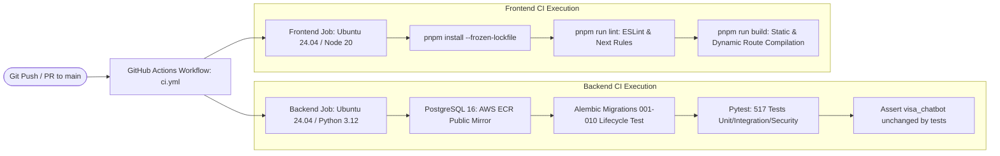

# System Architecture & Technical Specification: Pendu Visa Engine

**Platform:** Overseas Visa Chatbot (`Pendu`)  
**Scope:** Architecture, Security Guardrails, Ingestion, Decision Systems & Data Layer  
**Document Version:** 2.0 (Authoritative System Architecture)  
**Last Updated:** 2026-10-10  

---

## 1. Architectural Philosophy: Deterministic Primacy

In high-stakes legal domains like Canadian immigration (IRCC), probabilistic Large Language Models (LLMs) cannot be trusted to independently perform mathematical computations, verify statutory thresholds, or decide policy eligibility.

Pendu enforces **Deterministic Primacy**:
1. **Mathematical & Policy Truth:** Hard statutory rules (Proof of Funds, Canadian Language Benchmark score conversions, and Provincial Attestation Letter requirements) are evaluated deterministically in Python code with zero LLM involvement.
2. **LLM as a Narrative Engine:** The LLM is restricted to synthesizing, translating, and explaining verified facts retrieved from the authoritative IRCC policy vector store or computed by the rule engine.
3. **Bi-Directional Firewalls:** Unvetted queries are filtered pre-retrieval by an adversarial input guardrail; generated responses are vetted post-generation by a sentence-buffered streaming leakage shield.

---

## 2. High-Level System Flow

```mermaid
graph TD
    Client([User Browser / Client]) -->|HTTPS / Next.js UI| CDN[Next.js 14 App Router Frontend]
    CDN -->|API Requests: /api/v1| FastAPIGateway[FastAPI Application Gateway]

    subgraph Security & Firewall Tier
        FastAPIGateway --> IF[Input Firewall & Prompt Injection Detector]
        IF -->|Rejected| SafeRefusal[Safe Refusal Message (<15ms, 0 Tokens)]
        IF -->|Accepted| PIILogger[PII Redactor & Salted SHA-256 Telemetry]
        FastAPIGateway --> FileSec[Magic-Byte Document Upload & Sanitization]
    end

    subgraph Deterministic Decision Tier
        PIILogger --> RE{Deterministic Rule Match?}
        RE -->|Proof of Funds / CLB / PAL| RuleAnswer[Statutory Engine Result]
    end

    subgraph RAG & Generative Tier
        RE -->|General Guidance| RAG[Unified RAG Orchestrator]
        RAG --> QueryRewrite[Referential Memory & Query Re-writer]
        QueryRewrite --> DenseRetriever[ChromaDB Dense Retriever]
        DenseRetriever --> ContextFilter[IRCC Tier-1 Context Sanitizer]
        ContextFilter --> LLM[Local Ollama: llama3.2:3b / Gemini 1.5]
        LLM --> StreamGuard[Sentence-Buffered Output Guardrail]
        StreamGuard --> LegalDisclaimer[Statutory Legal Disclaimer Appender]
    end

    subgraph Relational & Crawler Tier
        Crawler[Crawler Worker & Throttle Manager] --> IRCC[Official Portals: canada.ca]
        Crawler --> CeleryRedis[Redis 7 Broker & Celery Tasks]
        Crawler --> RelationalDB[(PostgreSQL 16: Relational Tables)]
        Crawler --> ChromaStore[(ChromaDB: Vector Embeddings)]
    end

    LegalDisclaimer --> Client
    RuleAnswer --> Client
    SafeRefusal --> Client
```

---

## 3. Tier-by-Tier Architectural Breakdown

### 3.1 Presentation Tier (Frontend)
- **Framework:** Next.js 14 utilizing the App Router architecture.
- **Language & Runtime:** TypeScript (strict mode enabled), React 18, Node 20.
- **Styling:** Vanilla Tailwind CSS with modern dark/light mode responsive tokens.
- **Image Handling:** Next.js `<Image>` component utilizing `remotePatterns` configuration for secure, responsive Unsplash image delivery with zero Cumulative Layout Shift (CLS).
- **Core User Journeys:**
  - `/onboarding`: Dynamic profile intake capturing citizenship, education, language scores, and financial backing.
  - `/visa-risk`: Deterministic visual breakdown of profile risks, refusal indicators, and remedial recommendations.
  - `/chat`: Streaming conversational assistant with real-time token rendering, clickable citation badges, and contextual legal disclaimers.
  - `/sop`: Automated Statement of Purpose drafting interface targeting profile gaps.
  - `/destinations`: Guides for Canadian provinces, universities, and regional cost-of-living calculators.
  - `/demo-metrics`: Real-time observability dashboard displaying latency, token efficiency, and guardrail interception counts.

### 3.2 Security & Guardrail Tier
- **Input Guardrail (`backend/app/core/input_guardrail.py`):**
  - Evaluates every query before vector retrieval or LLM inference.
  - Detects code generation attempts, prompt injection payloads (e.g. `DAN`, `ignore previous instructions`, role reversals), and out-of-scope queries (e.g. general trivia, coding).
  - Returns safe refusal messages within $<15$ milliseconds, eliminating unnecessary compute and token costs.
- **Output Guardrail (`backend/app/core/output_guardrail.py` & `streaming_output_guardrail.py`):**
  - Inspects generated text sentence-by-sentence in streaming mode.
  - Scans for internal prompt leakages, delimiter tokens (`<system>`, `===`), backend filesystem paths (`/app/backend/...`), and sensitive environment variables.
  - Intercepts and rewrites unauthorized legal guarantees (e.g., *"We guarantee approval"* $\to$ conditional IRCC assessment language).
- **Statutory Legal Disclaimer Engine (`backend/app/core/legal_disclaimer.py`):**
  - Dynamically appends non-legal advice disclaimers compliant with Canadian immigration regulatory guidelines.
- **PII Redaction & Telemetry (`backend/app/core/logging_config.py`):**
  - Recursive regex filters sanitize logs across stream and rotating file handlers (`app.log`, `error.log`).
  - Redacts passports, Canadian SINs, IRCC Client ID/UCIs, phone numbers, emails, and bearer auth tokens.
  - Hashes user IDs with salted SHA-256 (`user_id_hash`) before persisting audit events.
- **Secure File Ingestion (`backend/app/services/file_service.py`):**
  - Inspects file header magic bytes (PDF `%PDF-`, JPEG `\xFF\xD8\xFF`, PNG `\x89PNG`).
  - Rejects executable formats (Windows PE `MZ`, Linux ELF, Mach-O, scripts).
  - Losslessly strips EXIF, IPTC, and PDF annotations/comments/JavaScript.
  - Neutralizes prompt injection directives embedded inside resumes or bank statements before text encapsulation.

### 3.3 Decision & Unified RAG Tier
- **Deterministic Rule Evaluator (`backend/app/services/rule_engine.py`):**
  - Evaluates statutory calculations without probabilistic models:
    - **Proof of Funds:** Encodes 2024 IRCC living costs ($20,635 base + tuition + dependents) with currency normalization.
    - **Language Conversion:** Maps IELTS, CELPIP-General, and PTE Core scores to Canadian Language Benchmark (CLB 4–10).
    - **PAL Evaluation:** Determines Provincial Attestation Letter requirements and exemption categories.
- **Unified RAG Orchestrator (`backend/app/services/unified_rag.py`):**
  - Coordinates conversational multi-turn context memory.
  - Resolves referential queries (e.g., "What are its requirements?" after discussing PGWP).
  - Enforces tier-1 IRCC policy primacy; queries with insufficient retrieval context trigger safe refusals rather than hallucinated completions.
- **Inference & Embeddings:**
  - Primary LLM: Local Ollama server running `llama3.2:3b`.
  - Fallback LLM: Google Gemini 1.5 Flash.
  - Embedding Engine: Local `nomic-embed-text` generating dense vector representations.
  - Vector Store: ChromaDB with persistent collection management.

### 3.4 Data & Crawler Tier
- **Relational Data Management:**
  - PostgreSQL 16 managed through SQLModel and Alembic migrations (revisions 001 through 010).
  - Background task scheduling managed via Redis 7 and Celery workers.
- **Database Safety Guardrails (`backend/app/core/database.py`):**
  - `DATABASE_AUTO_CREATE_TABLES` defaulted to `False` to prevent startup schema overwrites.
  - Schema auto-creation restricted exclusively to test environments and approved databases in `DISPOSABLE_DATABASE_ALLOWLIST`.
  - Tests never modify the local development database `visa_chatbot` (snapshot before/after); it is upgraded deliberately with `alembic upgrade head`.
- **Crawler Subsystem (`backend/app/services/crawler/`):**
  - Scrapes official government web sources (`canada.ca`, `cic.gc.ca`).
  - Implements anti-bot protections: robots.txt compliance, domain crawl delays, TLS browser fingerprint rotation, and proxy pools.
  - Throttling managed via `throttle_manager.py` with asynchronous token bucket algorithms.

---

## 4. Continuous Integration & Pipeline Architecture



The automated pipeline guarantees:
1. **Container Reliability:** PostgreSQL 16 image pulled from AWS ECR Public mirror (`public.ecr.aws/docker/library/postgres:16`) to avoid Docker Hub 429 rate limits.
2. **Third-Party Action Integrity:** All GitHub Actions pinned by immutable commit SHAs.
3. **Database Isolation:** Migration tests execute on transient disposable databases without touching development databases.
4. **Complete Coverage:** All 517 tests must pass and frontend compilation must produce zero errors or warnings before code merges to `main`.
